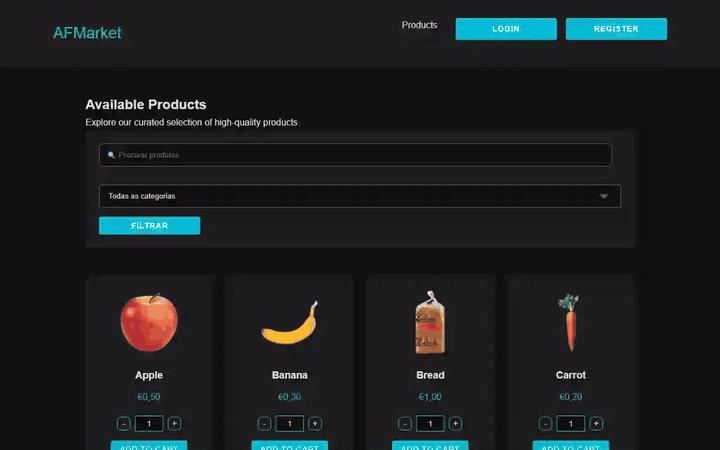
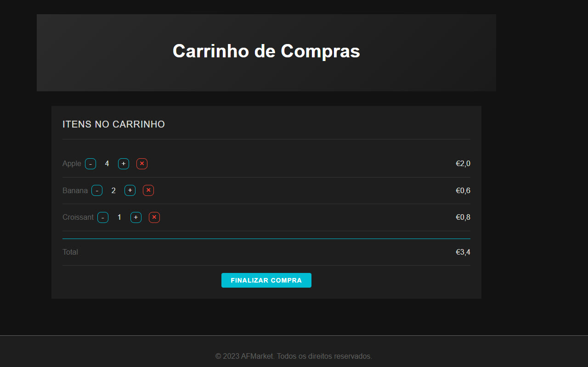
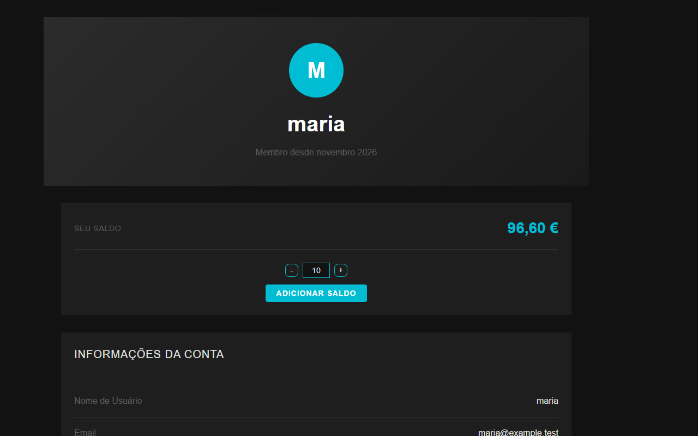

<h1 align="center">AFMarket</h1>

<p align="center">
  <strong>A full marketplace flow in ASP.NET Core MVC: browse, filter, cart, pay, track.</strong><br>
  Every euro and every unit of stock moves inside a database transaction.
</p>

<p align="center">
  <a href="https://github.com/netoaf/afmarket/actions/workflows/ci.yml"></a>
  
  
  
  
</p>

<p align="center">
  
</p>

<p align="center"><sub>Recorded on a local demo database: register, filter, add to cart, check out, balance drops from €100.00 to €96.60. <a href="docs/demo.mp4">Video</a>.</sub></p>

## The flow

<table>
  <tr>
    <td></td>
    <td></td>
    <td></td>
  </tr>
  <tr>
    <td align="center"><sub>1. Search and filter</sub></td>
    <td align="center"><sub>2. Cart with live totals</sub></td>
    <td align="center"><sub>3. Balance after checkout</sub></td>
  </tr>
</table>

## What it does

**For shoppers.** Catalogue with search, category filter and favourites. Per-user
cart with stock-aware quantities. Simulated wallet, one-click checkout and order
history.

**For admins.** Create, edit and remove products. Manage user accounts.

**Behind it.** A relational SQL Server model with nine entities: users, products,
categories, cart items, orders, order items, transactions, favourites and
promotions. Checkout validates stock and balance, then writes the order, debits the
wallet and decrements stock in a single transaction. Either everything happens or
nothing does.

## Security choices

- Passwords hashed with ASP.NET Core `PasswordHasher`
- Anti-forgery tokens validated on every state change
- Cart operations scoped to the session owner
- Management screens restricted to admin sessions
- No credentials in the repository; connection string comes from config

## Run it

Requires the .NET 8 SDK and SQL Server (LocalDB is enough).

```powershell
# 1. Create the demo database (drops and recreates only AFMarketDB)
sqlcmd -S "(localdb)\MSSQLLocalDB" -i database/reset-demo-database.sql

# 2. Start the app
dotnet run --project AFMarket/AFMarket.csproj
```

Register an account to receive a €100 demo balance. To reach the admin screens,
promote that account with the query at the end of the SQL script. For a different
SQL Server, override `ConnectionStrings:DefaultConnection` with user secrets or an
environment variable.

## Honest scope

A school project, built independently with AI as a development aid. Payments are
simulated and authentication is a small session-based layer. A production version
would move to ASP.NET Core Identity, EF migrations, policy-based authorization and
integration tests.
