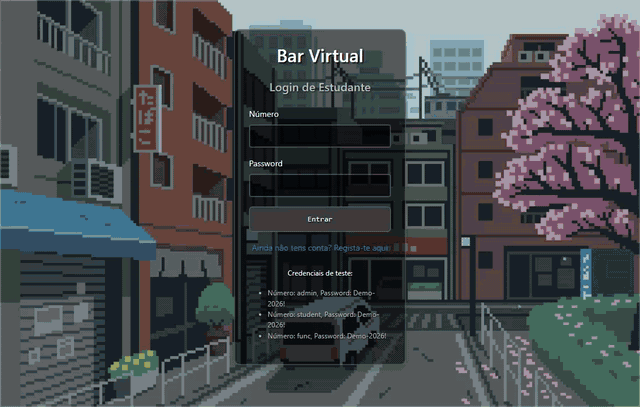
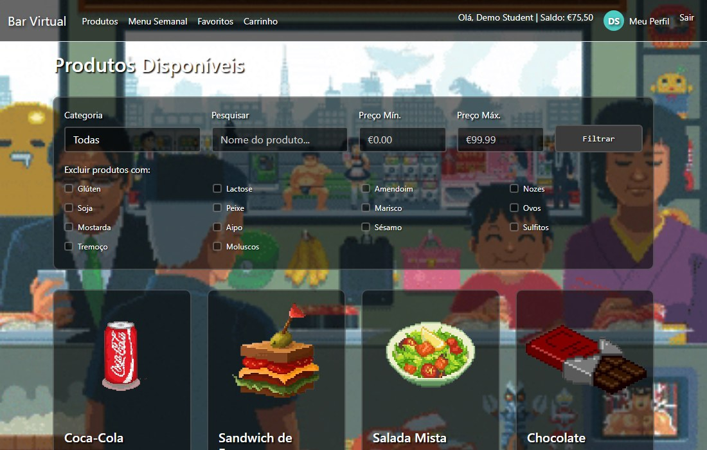
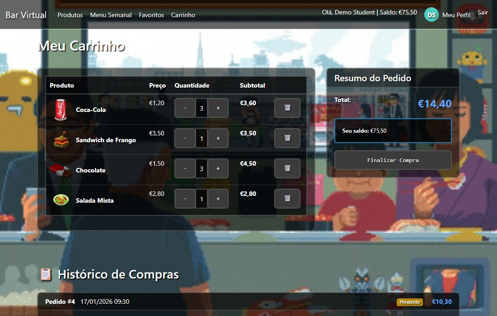
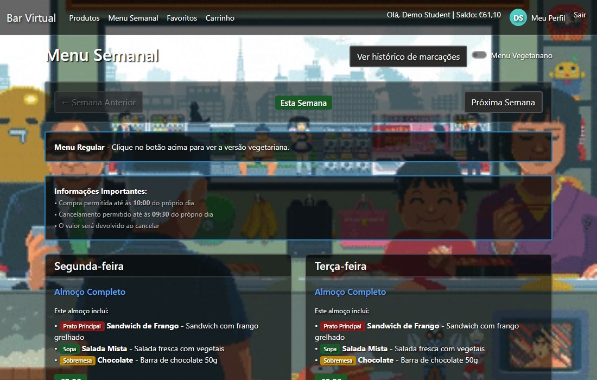
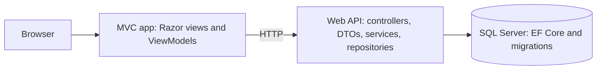

# Refeitório

**A school cafeteria system in ASP.NET Core: students order and reserve meals, staff run the counter, admins manage the menu. Two projects, strict layers.**

<p align="center">
  <a href="https://github.com/netoaf/afmarket/actions/workflows/ci.yml"></a>
  
  
  
  
</p>

Built alone as a school project. The presentation layer never touches the database: it only talks to a Web API, which owns the business rules and the data.

<p align="center">
  
</p>

<p align="center"><sub>Recorded on a local demo database: a student logs in, adds products, checks out, and the balance drops from €75.50 to €61.10.</sub></p>

## The flow

<table>
  <tr>
    <td></td>
    <td></td>
    <td></td>
  </tr>
  <tr>
    <td align="center"><sub>1. Catalogue and filters</sub></td>
    <td align="center"><sub>2. Cart with live totals</sub></td>
    <td align="center"><sub>3. Weekly menu</sub></td>
  </tr>
</table>

## Architecture



| Project | Role |
|---|---|
| `refeitorio/` | ASP.NET Core MVC front end. No database access, ViewModels only. |
| `Refeitorio_API/` | Web API with services, repositories, domain models, DTOs and EF Core migrations. |
| `RefeitorioDB.sql` | Schema and demo seed data. |

Why it is split this way is explained in [`TECHNICAL_DECISIONS.md`](TECHNICAL_DECISIONS.md).

## What each role can do

| Role | Features |
|---|---|
| **Student** | Browse products with search and category filter, vegetarian flag, nutrition and allergens. Cart, orders and order history, favourites. Weekly menu and meal-ticket reservations. Profile and balance. |
| **Staff** | Manage products and categories. See incoming orders and order history. |
| **Admin** | Everything staff can do, plus student accounts and the weekly menu. |

## Security choices

- Passwords are hashed with ASP.NET Core Identity `PasswordHasher`; no plain-text passwords in code or seed data.
- Public registration always creates a Student. The client cannot choose its own role.
- Connection strings contain no credentials (Windows authentication).
- Known gap: the API itself does not yet require a token. See [`LIMITATIONS.md`](LIMITATIONS.md).

## Run it

Requires the .NET 8 SDK and SQL Server (Express or LocalDB). Full steps in [`SETUP.md`](SETUP.md).

```powershell
sqlcmd -S ".\SQLEXPRESS" -f 65001 -i RefeitorioDB.sql
dotnet run --project Refeitorio_API/WebApplication1   # https://localhost:7091
dotnet run --project refeitorio/refeitorio            # https://localhost:7073
```

With LocalDB instead of SQL Express, override the connection string with an environment variable, for example `ConnectionStrings__DefaultConnection="Server=(localdb)\MSSQLLocalDB;Database=RefeitorioDB;Trusted_Connection=True;TrustServerCertificate=True"`. The seeded weekly menu is dated January 2026, so add rows for the current week to see it filled.

Demo accounts (local only): `admin`, `student`, `func`, all with password `Demo-2026!`. These accounts exist only in the demo seed script. Delete them before any real deployment.

## Honest scope

A school project, built independently. The order and balance logic is covered by xUnit tests (`Refeitorio_API/WebApplication1.Tests`, run in CI); the rest has no automated tests yet, the API has no authentication, and sessions live on the server. A production version would add token auth, wider test coverage, transactional checkout and environment-based configuration. The CI workflow in this repository builds both solutions on every push.
